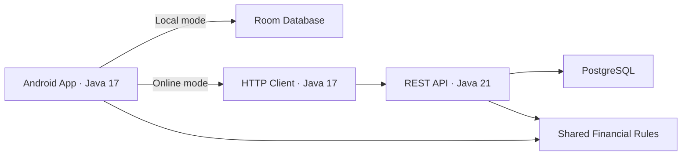

# Spendi — Android Expense Tracker & Java Backend

[](https://github.com/DanaTahaa/Spendi/actions/workflows/verify.yml)

Spendi is a personal finance application for tracking income, expenses,
and monthly budgets. It combines an Android application built with
**Java 17** with a **Java 21 REST API** backed by **PostgreSQL**.

The project focuses on exact financial calculations, reliable API
operations, user data isolation, and automated testing.

## Features

- Create, edit, and delete income and expense transactions.
- Browse transactions by month and filter by transaction type.
- Search transactions by category or notes.
- Set monthly budgets and track remaining or exceeded amounts.
- View monthly income, expenses, balance, and category summaries.
- Choose between local Room storage and online API storage.
- Preserve existing local records when switching data sources.

## Engineering Highlights

### Exact Financial Calculations

Individual amounts are stored as integer minor units.
Aggregate calculations use `BigDecimal` to avoid floating-point
rounding errors and overflow when summing multiple valid amounts.

Amount validation supports English, Arabic-Indic, and Persian digits,
while rejecting unsupported precision and invalid values.

### Reliable API Operations

- **Idempotent creation:** retries using the same idempotency key
  do not create duplicate transactions.
- **Optimistic locking:** updates and deletes include a record version;
  stale operations return a conflict.
- **User ownership:** database queries restrict access to records
  belonging to the authenticated subject.
- **Strict validation:** invalid request fields, amounts, dates,
  and unsupported operations are rejected.

### Persistence and Credential Protection

- PostgreSQL persistence with Flyway database migrations.
- Generated jOOQ types for database access.
- Android Keystore encryption for saved connection credentials.
- Connection credentials excluded from Android backup and transfer.
- HTTPS required in release builds.
- Explicit separation between local and online records.

## Architecture



Local mode uses Room on the device. Online mode communicates with the
backend through the shared HTTP client.

Switching modes does not automatically upload, merge, or delete
existing local records.

## Technology Stack

| Area | Technologies |
| --- | --- |
| Android | Java 17, Room, Material Components |
| Backend | Java 21, JDK HttpServer, virtual threads |
| Database | PostgreSQL |
| Database access | jOOQ, HikariCP |
| Database migrations | Flyway |
| Authentication | RS256 JWT verification with configured issuer, audience, and HTTPS JWKS |
| Testing | JUnit, Spock, Android instrumentation |
| Build and automation | Gradle, GitHub Actions, PowerShell |

## Repository Structure

```text
Spendi/
├── app/          Android UI, Room storage, and data-source integration
├── api-client/   Shared Java 17 HTTP client
├── core/         Financial validation and calculation rules
├── backend/      Java 21 API and PostgreSQL persistence
├── scripts/      Local development and Android connection commands
├── docs/         Architecture, setup, and verification documentation
└── .github/      Continuous integration workflow
```

## Getting Started

### Requirements

- JDK 21.
- Android Studio or Android command-line tools.
- Android SDK 37.
- An Android device or emulator for running the application.
- Internet access for the initial dependency download.

The Android application requires Android API 26 or later.

### Clone the Repository

```bash
git clone https://github.com/DanaTahaa/Spendi.git
cd Spendi
```

Open the repository root in Android Studio.

Configure the Android SDK through `ANDROID_HOME` or an untracked
`local.properties` file containing `sdk.dir`.

### Build and Test Android

Windows PowerShell:

```powershell
$env:JAVA_HOME='C:\Program Files\Java\jdk-21'

.\gradlew.bat :core:test :api-client:test :app:testDebugUnitTest :app:lintDebug :app:assembleDebug
```

Linux / macOS:

```bash
export JAVA_HOME=/path/to/jdk-21

bash ./gradlew :core:test :api-client:test :app:testDebugUnitTest :app:lintDebug :app:assembleDebug
```

Adjust the JDK path to match your installation.

### Start the Local Backend — Windows

The development launcher starts the Java API and a persistent native
PostgreSQL database without requiring Docker.

```powershell
.\scripts\start-local.ps1 -JavaHome 'C:\Program Files\Java\jdk-21'
```

Local API:

```text
http://127.0.0.1:8080
```

Readiness endpoint:

```text
GET /health/ready
```

Database files and generated development credentials are stored in
the Git-ignored `.local-spendi/` directory.

This launcher is intended for local development. Its database uses
loopback-only development authentication.

### Connect an Android Emulator

Build the application and instrumentation APK:

```powershell
.\gradlew.bat :app:assembleDebug :app:assembleDebugAndroidTest
```

Start an emulator and check its serial:

```powershell
$adb = "$env:LOCALAPPDATA\Android\Sdk\platform-tools\adb.exe"

& $adb devices
```

Run the integration test, then configure the debug application:

```powershell
.\scripts\test-android-local.ps1 -Adb $adb -Serial emulator-5554

.\scripts\connect-android-local.ps1 -Adb $adb -Serial emulator-5554
```

Replace `emulator-5554` if your emulator uses a different serial.

The emulator connects to the host API through `http://10.0.2.2:8080`.
The connection script configures the development credentials without
printing them to the console.

### Stop the Local Backend

```powershell
.\scripts\stop-local.ps1
```

Stopping the service preserves the PostgreSQL data directory.

For other backend configurations, see the
[backend setup guide](backend/README.md).

## Testing and Verification

The documented verification run passed **104 JVM and PostgreSQL tests**,
plus a separate **Android emulator integration test**.

| Test Area | Cases |
| --- | ---: |
| Shared financial rules | 36 |
| HTTP client | 8 |
| JWT and configuration validation | 15 |
| Backend input and JSON validation | 29 |
| PostgreSQL and API integration | 11 |
| Android JVM tests | 5 |

The Android emulator test additionally verifies:

- Encrypted credential storage.
- Transaction creation and safe retries.
- Listing, reading, editing, and deleting transactions.
- Rejection of stale updates.
- Monthly summary retrieval.
- Unavailable-server error handling.
- Preservation of local Room transaction data.

PostgreSQL integration tests run against a real PostgreSQL database.

Persistence was also verified by creating a transaction, gracefully
restarting the local API and database, and retrieving the same record.

See the [verification report](docs/ANDROID_CONNECTION_VALIDATION.md).

## Continuous Integration

GitHub Actions verifies:

- Shared domain and HTTP client tests.
- Backend tests against PostgreSQL.
- Android unit tests and lint.
- Debug APK and instrumentation APK builds.
- Release manifest processing.
- Backend distribution builds.

Android instrumentation tests are compiled in CI and executed separately
on an emulator with the local API running.

## Documentation

- [Backend setup and API examples](backend/README.md)
- [OpenAPI specification](backend/openapi.yaml)
- [Android connection and local development](docs/ANDROID_BACKEND_CONNECTION.md)
- [Backend architecture decisions](docs/ADR_002_BACKEND.md)
- [Android and API verification](docs/ANDROID_CONNECTION_VALIDATION.md)

## Current Scope and Limitations

- The application supports local storage and online API operations.
- Online mode currently uses bearer-token configuration.
- The backend verifies JWT access tokens; it does not issue tokens
  or provide a user registration service.
- Local Room records and server records remain separate.
- OAuth sign-in, offline cloud synchronization, and public cloud
  deployment are not implemented.
- The project currently supports USD amounts.

## Author

**Dana Taha**

[GitHub — @DanaTahaa](https://github.com/DanaTahaa)
